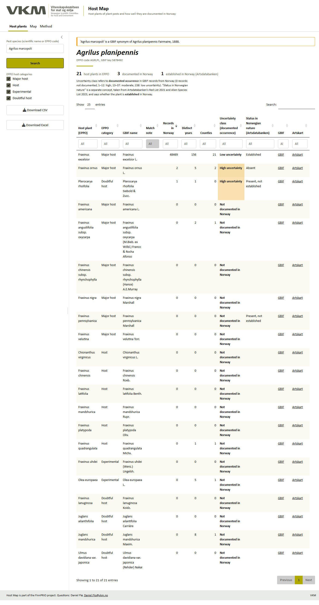
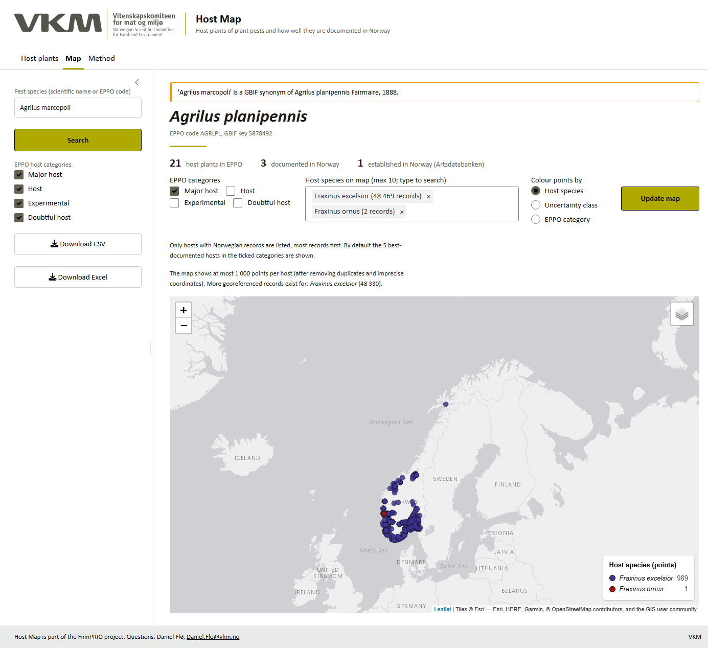
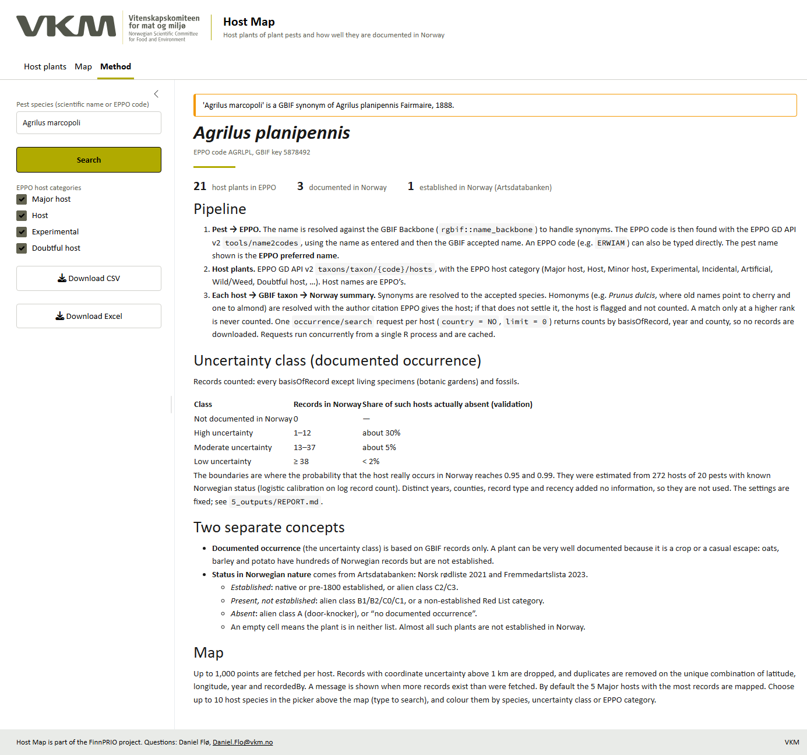

# Host Map: a walk-through

*Host Map is part of the FinnPRIO project (VKM). Contact: Daniel Flø <Daniel.Flo@vkm.no>.*

This vignette uses emerald ash borer as the example. It shows how to read the app's output, and why "documented in Norway" and "established in Norway" are kept apart.

## 1. Search

Type a pest name or an EPPO code in **Pest species** and press **Search**. Synonyms work. Here *Agrilus marcopoli* was entered; GBIF reports it as a synonym of *Agrilus planipennis*, and the app says so in an orange note. The heading is always the EPPO preferred name, followed by the Norwegian name (if EPPO has one), the EPPO code and the GBIF key.

Under the pest name, three counts summarise the (filtered) host list:

* **Hosts**: number of EPPO host records.
* **Documented in Norway**: hosts with at least one GBIF record in Norway.
* **Established in Norway**: hosts that Artsdatabanken lists as established in Norwegian nature.

## 2. Read the host table

Each row is one EPPO host. The columns:

| Column | Meaning |
|---|---|
| Host plant (EPPO), EPPO category | Name and category exactly as in the EPPO Global Database |
| GBIF name, Match note | The accepted GBIF taxon used for counting. The note flags synonyms, ambiguous names and names that could not be matched |
| Records in Norway, Distinct years, Counties | GBIF records from Norway (all record types except botanic-garden living specimens and fossils) |
| **Uncertainty class** | How sure we can be that the host **occurs** in Norway, judged from the records |
| **Status in Norwegian nature** | Artsdatabanken's assessment of whether it is **established** |
| GBIF, Artskart | Links to the records |

The uncertainty classes are calibrated against Artsdatabanken's lists (see `5_outputs/REPORT.md`):

| Class | Records | Of such hosts, share actually absent from Norway |
|---|---|---|
| Not documented in Norway | 0 | — |
| High uncertainty | 1–12 | about 30% |
| Moderate uncertainty | 13–37 | about 5% |
| Low uncertainty | ≥ 38 | < 2% |

**How to read the example.**

* *Fraxinus excelsior* (major host) has 48,000 records, low uncertainty, and is established. The pest would find its main host here.
* *Fraxinus ornus* has 2 records (high uncertainty), and Artsdatabanken says it is *absent*. The few records are planted trees or casual finds, which is exactly the situation the "high uncertainty" class warns about.
* Most American and Asian *Fraxinus* species have no Norwegian records.

**Why the two concepts differ.** A plant can have low uncertainty for documented occurrence and still not be established. Crops are the typical case: oats, barley and potato have hundreds of Norwegian records but no wild populations. For a pest risk assessment, use the uncertainty class to judge whether the host is *there*, and the Artsdatabanken status to judge whether it occurs *in nature*.

Use the column filters (e.g. type "Low" under Uncertainty class) and the **EPPO host categories** checkboxes in the sidebar to narrow the list. **Download CSV / Excel** exports the filtered table. The Excel file has a *settings* sheet with the pest, date and classification rule.

## 3. Map

After a search the map shows the 5 hosts with the most records among the ticked **EPPO categories** (default: Major host). To map other hosts, pick up to 10 in **Host species on map**. Type to search; this matters for pests like *Xylella fastidiosa* with 600 hosts. Then press **Update map**.

* By default each host species gets its own colour, and the legend lists the species with the number of points shown. Points can also be coloured by uncertainty class or EPPO category.
* Each host is its own layer and can be switched on and off in the layer box. The base map can be changed there too.
* At most 1,000 points are fetched per host. The note above the map says when more records exist. Points with coordinate uncertainty above 1 km are left out, and duplicates of the same place, year and recorder are shown once.

## 4. Method

The **Method** tab gives the full pipeline, the classification and its validation in short form.

## 5. Good to know

* **No EPPO code found**: try the accepted name or type the EPPO code directly (find it at <https://gd.eppo.int>).
* **"could not be resolved to a GBIF taxon"**: the host name is not in the GBIF Backbone, or is ambiguous. These rows show no counts. Check the Match note.
* **Genus or family hosts** (e.g. *Rosa*, Poaceae) are counted at that rank, so their counts are naturally high.
* GBIF counts change over time. The thresholds should be re-validated about once a year with `4_scripts/02_validation_analysis.R`.
