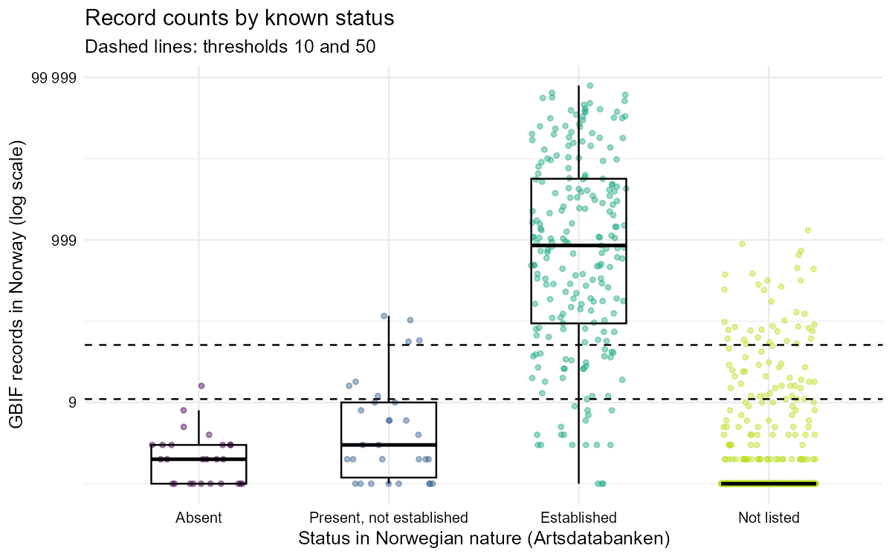
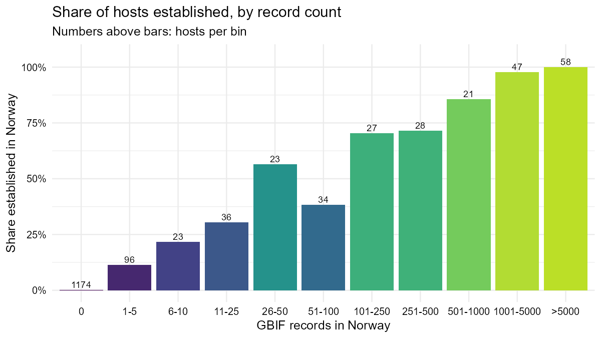
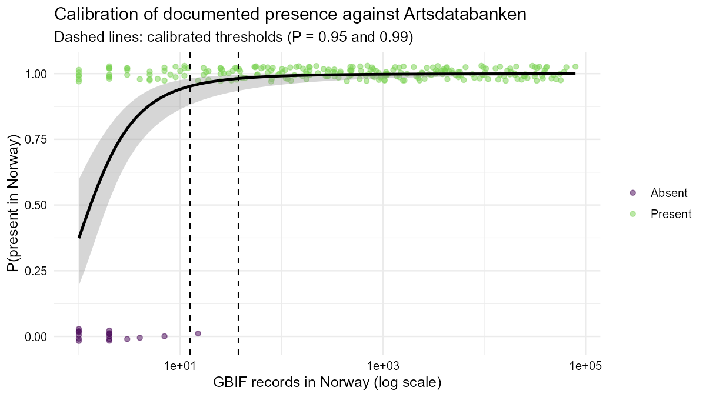
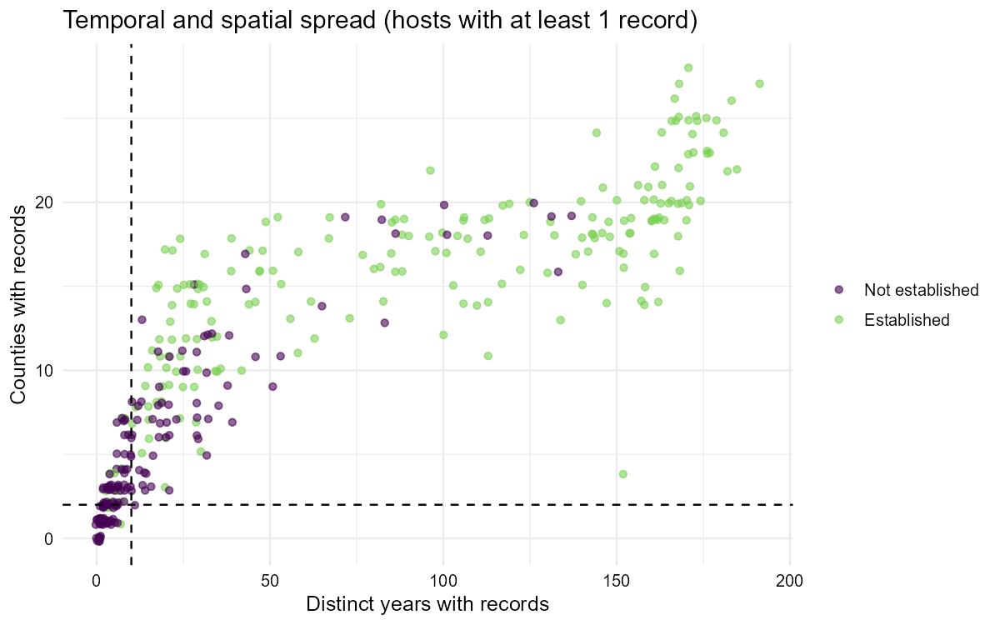

# Host Map: feasibility and statistical reassessment of the uncertainty classification

*Host Map is part of the FinnPRIO project, VKM. Contact: Daniel Flø <Daniel.Flo@vkm.no>. Date: 2026-11-04.*

## Summary

* The app is feasible with open APIs: **EPPO GD API v2** for host lists (free key), **GBIF** for names and Norwegian record counts (no key), and **Artsdatabanken** for status in Norwegian nature (no key).
* A host's GBIF record count in Norway is a good measure of **documented occurrence**. It is not a reliable measure of **establishment**, because crops and casual aliens (oats, barley, potato, sunflower, flax) have hundreds of records without being established. The app therefore shows the two concepts in separate columns, and takes establishment directly from Artsdatabanken.
* The classes were recalibrated against known presence in Norway. The new boundaries are where the probability that a host really occurs in Norway reaches 0.95 and 0.99. This gives **0 / 1–12 / 13–37 / ≥ 38 records**, replacing 0 / 1–10 / 11–50 / > 50.
* Adding time (distinct years), space (counties), record type (human observation vs. specimen) or recency did **not** improve the classification of documented presence. The rule therefore stays count-only, and excludes living specimens (botanic gardens) and fossils.
* The thresholds are fixed in the app. Users can no longer change them.

## 1. Feasibility

| Requirement | Finding | Implementation |
|---|---|---|
| Name resolution, synonyms | `rgbif::name_backbone` resolves synonyms (e.g. *Agrilus marcopoli* → *A. planipennis*). For ambiguous synonyms GBIF falls back to a higher rank (e.g. *Picea excelsa* → Pinaceae). | The exact-match alternatives are inspected and the most frequent accepted species is chosen, with a note. A higher-rank match is never counted (otherwise a misspelt host would count all Pinaceae or Plantae records). |
| EPPO code from name | The EPPO v2 API has `tools/name2codes`. The older v1 REST API rejected this key. | The name is tried as entered, then the GBIF accepted name. An EPPO code can also be entered directly. The displayed pest name is the **EPPO preferred name** (`taxons/taxon/{code}/overview`), plus the Norwegian name. |
| Host list and categories | `taxons/taxon/{code}/hosts` gives the category labels (Major host, Host, Minor host, Experimental, Incidental, Artificial, Wild/Weed, Doubtful host, …). | Categories are shown and filterable. The map defaults to Major hosts. |
| API key | Required by EPPO. A missing or invalid key gives HTTP 401. | `EPPO_API_KEY` environment variable, read at the top of `app.R`, with a clear message if it is missing or rejected. |
| Speed | One GBIF facet request (`limit = 0`, facets basisOfRecord/year/county) takes about 0.25–0.4 s. Xylella has 603 hosts. | Bulk requests run concurrently from one R process (`httr2::req_perform_parallel`, at most 4 at a time, backoff on HTTP 429). There are no extra R sessions, which suits **shinyapps.io**. Every call is cached. The 1,867 validation hosts took about 9 minutes the first time; cached queries are instant. |
| Map points | Some hosts have more than 60,000 Norwegian records. | At most 1,000 points per host, in one paged request with all counted basisOfRecord values combined. Points with coordinate uncertainty above 1 km are dropped and duplicates on (lat, lon, year, recordedBy) are removed. A message is shown when more records exist. |
| Reference "status in Norway" | The Artsdatabanken OData API (Red List 2021, Alien Species List 2023) is open. | Downloaded once (`4_scripts/00_fetch_reference.R`) and shipped with the app, so startup makes no network calls. |
| Base map | CARTO and Stadia tiles now show "API key required" in the browser. | Esri World Light Gray Base (default), Esri Terrain and OpenStreetMap, loaded by URL. |

## 2. Validation design

* **Sample.** 20 pests relevant to Norway were chosen to span narrow to very wide host ranges: *Erwinia amylovora, Popillia japonica, Phytophthora ramorum, Agrilus planipennis, Xylella fastidiosa, Anoplophora glabripennis, A. chinensis, Bursaphelenchus xylophilus, Dendrolimus sibiricus, Thaumetopoea processionea, Lymantria dispar, Leptinotarsa decemlineata, Globodera rostochiensis, Ralstonia solanacearum, Synchytrium endobioticum, Aromia bungii, Phytophthora kernoviae, Bactrocera dorsalis, Spodoptera frugiperda, Ceratocystis platani*. They have 2,349 pest–host links and 1,867 unique host names. After keeping species-rank hosts and de-duplicating on GBIF taxon there are **1,567 hosts**.
* **Features per host.** GBIF records in Norway (excluding living and fossil specimens), human observations, preserved specimens, distinct years, counties (GADM level 1), and first and last year.
* **Known status.** From Artsdatabanken, matched on the EPPO name, the GBIF name, and Norwegian synonyms via Nortaxa:
  * *Established*: native or pre-1800 established, or alien class C2/C3. 217 hosts.
  * *Present, not established*: alien class B1/B2/C0/C1, or a non-established Red List category. 30 hosts.
  * *Absent*: door-knocker class A, or "no documented occurrence". 26 hosts.
  * *Not listed*: 1,294 hosts, mostly exotic plants (*Coffea*, *Citrus*, tropical crops).
* **Two targets.**
  1. *Documented presence in Norway* (established or present-not-established vs. absent; listed hosts only, n = 273). This is what the uncertainty class is meant to describe.
  2. *Established in Norwegian nature* (established vs. all others). Three scenarios: A, all hosts with "not listed" counted as not established; B, only hosts with at least 1 record; C, listed hosts only.
* **Comparison of rules.** Repeated stratified 5-fold cross-validation (10 × 5). Each rule's parameters were tuned on the training folds (maximising balanced accuracy) and scored on the held-out fold. Thresholds were estimated by logistic calibration on log10(count + 1), with 2,000 bootstrap resamples for CIs.

Scripts: `4_scripts/01_validation_collect.R`, `4_scripts/02_validation_analysis.R`. All tables and figures are in `5_outputs/`.

## 3. Results

### 3.1 Original classes against known status

| Original class | Absent | Present, not est. | Established | Not listed |
|---|---|---|---|---|
| Not documented (0) | 10 | 8 | 3 | 1,153 |
| High (1–10) | 15 | 15 | 16 | 73 |
| Moderate (11–50) | 1 | 3 | 24 | 31 |
| Low (> 50) | 0 | 4 | 174 | 37 |

For listed hosts, the overall agreement of the ordinal reading (0 → absent, 1–50 → present, > 50 → established) is **74%**, with a weighted κ of **0.64**.

* **Documented presence.** "≥ 1 record" has sensitivity 0.96 but specificity only 0.38. Most absent species with records have 1–2 records, which are casual finds, imports or misidentifications.
* **Established.** "> 50 records" has sensitivity 0.80 and specificity 0.97 over all hosts. For hosts with at least 1 record the specificity drops to 0.77.

### 3.2 Where misclassification happens

| Records | Hosts | Share established |
|---|---|---|
| 0 | 1,174 | 0.3% |
| 1–5 | 96 | 11% |
| 6–10 | 23 | 22% |
| 11–25 | 36 | 31% |
| 26–50 | 23 | 57% |
| 51–100 | 34 | 38% |
| 101–250 | 27 | 70% |
| 251–500 | 28 | 71% |
| 501–1000 | 21 | 86% |
| > 1000 | 105 | 99% |

* **For establishment**, errors are concentrated between **25 and 500 records**. Almost every high-count host that is not established is a cultivated crop or a casual alien. Examples: *Avena sativa* (1,313 records), *Helianthus annuus* (889), *Hordeum vulgare* (732), *Linum usitatissimum* (652), *Solanum tuberosum* (314), *Zea mays* (122). In the other direction, hosts with 10–45 records include established aliens such as *Abies balsamea*, *Prunus serotina*, *Pinus strobus* and *Acer negundo*.
* **For documented presence**, errors are concentrated at **1–5 records**.

### 3.3 Calibration for documented presence (the recommended basis)

Risk that a host in each class is actually absent from Norway (listed hosts, Wilson 95% CI):

| Class | Original (10/50) | Calibrated (12/37) |
|---|---|---|
| High uncertainty | 15/46 = **33%** (21–47%) | 15/50 = **30%** (19–44%) |
| Moderate uncertainty | 1/28 = **3.6%** (0.6–18%) | 1/19 = **5.3%** (0.9–25%) |
| Low uncertainty | 0/178 = **0%** (0–2.1%) | 0/183 = **0%** (0–2.1%) |

Logistic calibration, P(present) = f(log10(count + 1)), n = 252 listed hosts with at least 1 record:

| Boundary | Target P(present) | Records (point) | Bootstrap 95% CI |
|---|---|---|---|
| High → moderate | 0.95 | 12.8 | 4.7–25.7 |
| Moderate → low | 0.99 | 37.7 | 8.6–116 |

Do other variables add information beyond the count? Likelihood-ratio tests against the log-count model:

| Added variable | p | ΔAIC |
|---|---|---|
| log distinct years | 0.80 | +2.0 |
| counties | 0.66 | +1.8 |
| share of human observations | 0.83 | +2.0 |
| last record ≥ 2000 | 0.012 | −4.4, but quasi-separation (all 16 absent hosts with records have a record from 2000 or later; SE ≈ 2,000), so not usable |

The single-variable AUCs for presence are similar: count (excl. living) 0.954, count incl. living specimens 0.941, years 0.944, counties 0.942, human observations 0.936, preserved specimens 0.938. Excluding living specimens is slightly better than including them.

### 3.4 Alternative rules for establishment (cross-validated balanced accuracy)

| Rule | A: all hosts | B: hosts with ≥ 1 record | C: listed only |
|---|---|---|---|
| Count only, original t = 50 | 0.886 | 0.792 | 0.865 |
| Count, tuned t | 0.943 (t = 1) | 0.813 (t = 100) | **0.902** (t = 20) |
| Count + years | 0.939 | 0.812 | 0.900 |
| Count + counties | 0.942 | 0.818 | 0.887 |
| Count + years + counties | 0.939 | 0.816 | 0.884 |
| Earlier draft rule (> 50 & ≥ 10 years & ≥ 2 counties) | 0.886 | 0.792 | 0.865 |
| Counties only | 0.934 | 0.828 (≥ 10) | 0.887 |
| Human observations only | 0.933 | **0.836** (> 30) | 0.862 |
| Human > 30 and preserved > 3 | 0.924 | 0.830 | 0.859 |
| Logistic, log count | 0.928 | 0.810 | 0.898 |
| Logistic, log count + years + counties + preserved share | 0.930 | 0.824 | 0.882 |

(The cross-validation SD of balanced accuracy is 0.01–0.05.)

* In the logistic model for establishment, the **preserved-specimen share** has a negative effect (β = −1.69, p = 0.001), while years and counties have none. Casual and cultivated plants are recorded mainly as herbarium specimens, established plants mainly as field observations.
* The best tuned thresholds disagree across scenarios (t = 1, 20 or 100). Spatial and temporal spread only give gains of 0.01–0.03, within the CV noise.
* The draft "revised" rule (> 50 records **and** ≥ 10 years **and** ≥ 2 counties) never differs from the plain count rule, because hosts with > 50 records always meet the spread criteria.

## 4. Recommendations and changes made

1. **Keep the classification count-based and calibrate it to explicit error rates.** The boundaries are where P(host present in Norway) = 0.95 and 0.99:
   * **0** records: not documented.
   * **1–12**: high uncertainty (about 30% of such hosts are actually absent).
   * **13–37**: moderate uncertainty (about 5%).
   * **≥ 38**: low uncertainty (< 2%).

   The original 10/50 lie inside the bootstrap CIs, so the change is a refinement with a stated probabilistic meaning, not a reversal.
2. **Count every basisOfRecord except LIVING_SPECIMEN and FOSSIL_SPECIMEN.** Botanic-garden accessions do not document occurrence in Norwegian nature.
3. **Do not add years, counties, record type or recency to the presence classification.** They carry no information beyond the count in this validation set.
4. **Do not infer establishment from GBIF.** The app shows Artsdatabanken's status as a separate column. If an establishment indicator is ever needed for unlisted taxa, the best GBIF-only rule found was "> 30 human observations" (balanced accuracy 0.84). That is too weak to replace the reference.
5. **Changes to the app:**
   * Thresholds and the basisOfRecord set are fixed constants (`UNCERTAINTY_T1 = 12`, `UNCERTAINTY_T2 = 37`, `GBIF_BASIS_COUNTED`) and are no longer user settings.
   * The draft "revised" rule was removed.
   * The table caption and the Excel settings sheet state the classes and their meaning.

## 5. Limitations

* Only 26 known-absent hosts were available, so the thresholds have wide CIs. Adding more pests with temperate host lists would narrow them.
* The reference is name-matched. Some established species may be missed because of taxonomic differences, despite the GBIF and Nortaxa synonym matching.
* "Not listed" was treated as not established (closed-world assumption, scenario A). Scenarios B and C show how sensitive the conclusions are to that.
* GBIF counts grow over time, and citizen-science effort is uneven. The calibration should be re-run (`02_validation_analysis.R`) about once a year.
* The validation is at species rank. Genus- or family-level EPPO hosts (e.g. *Rosa*, Poaceae) are counted at that rank in the app, and their counts are naturally high.
